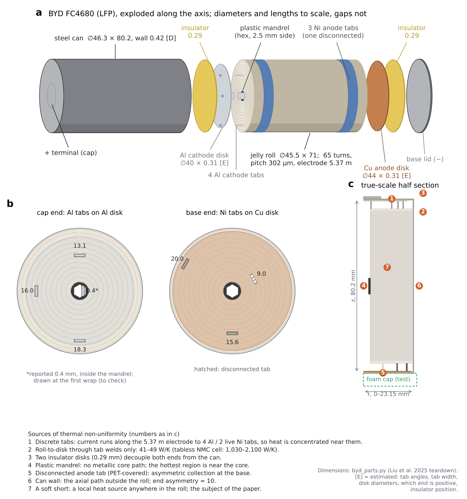
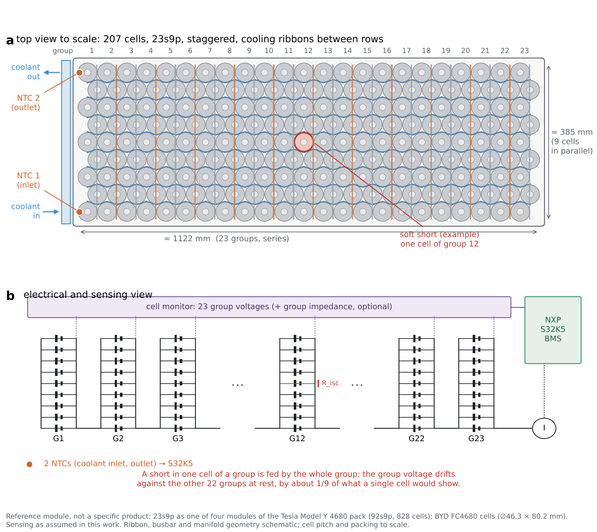
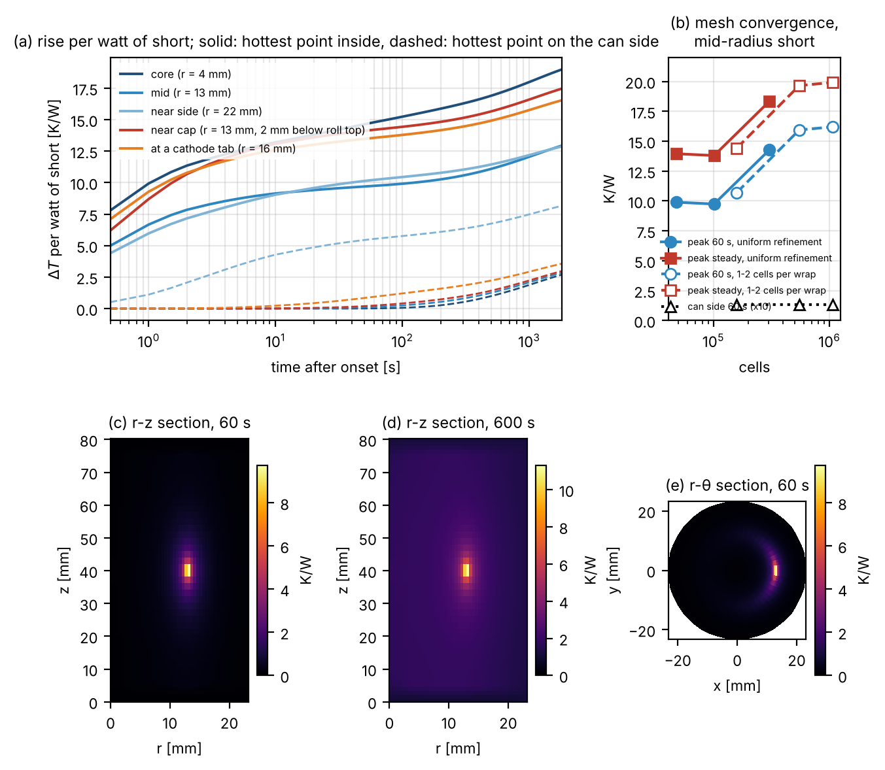
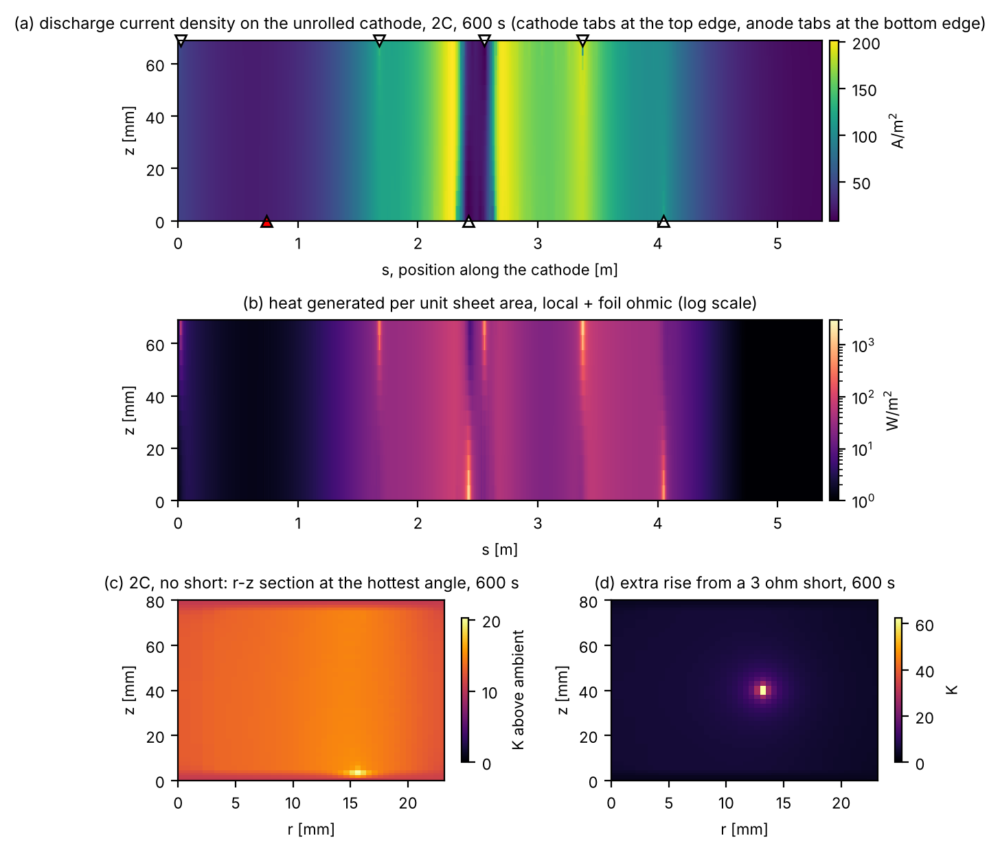
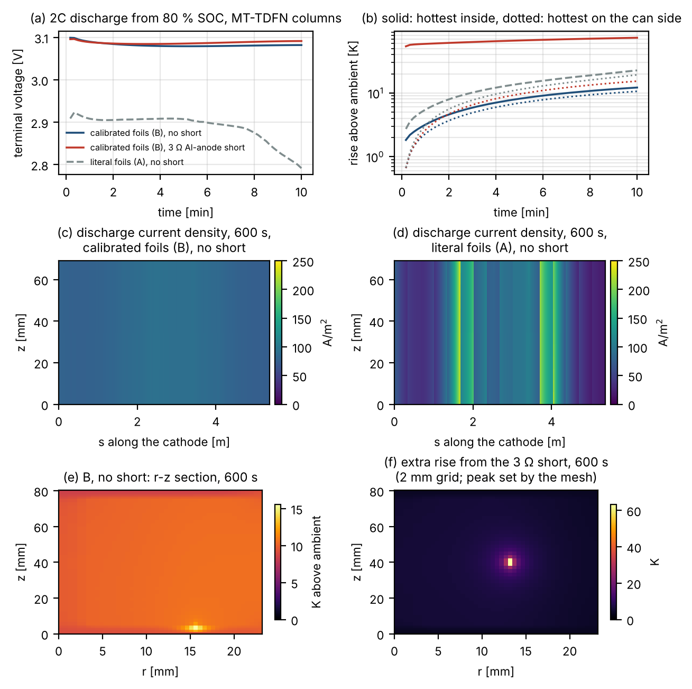
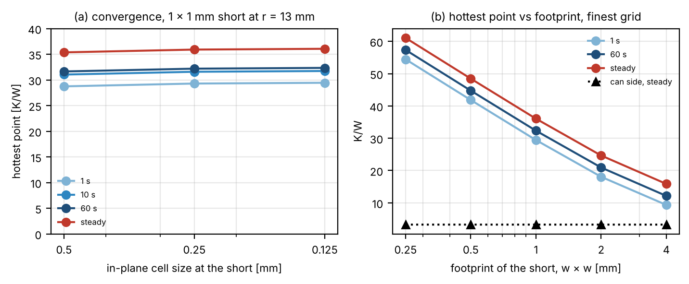
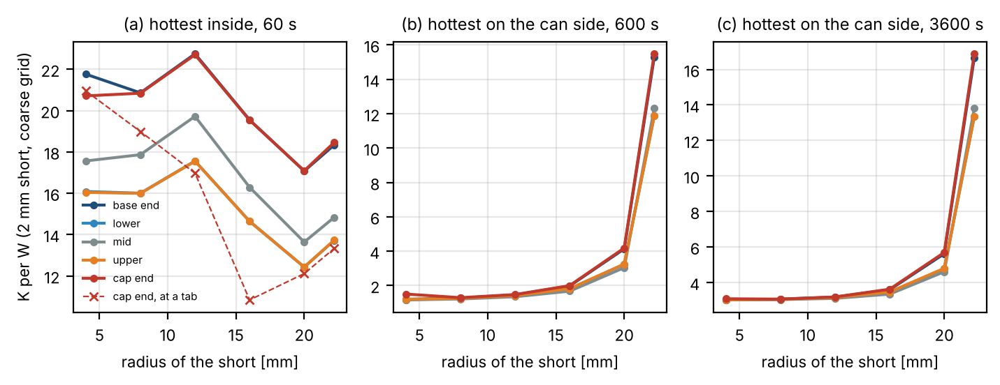

# 3-D thermal model of an LFP 4680 cell for real-time hotspot scanning (paper 1.2)

**Status:** in preparation (work in progress, November 2026). This branch holds the two digital twins of the paper. Results will change as the model develops.

[](https://colab.research.google.com/github/RemusTeodorescu/4680-cell-models/blob/paper-1.2-3d-thermal-model/3D-thermal-model-of-LFP-4680-cell-for-hotspot-scanning/notebooks/cell_twin_colab.ipynb)
[Open the module twin in the browser](https://htmlpreview.github.io/?https://github.com/RemusTeodorescu/4680-cell-models/blob/paper-1.2-3d-thermal-model/3D-thermal-model-of-LFP-4680-cell-for-hotspot-scanning/module_twin/module_twin.html)

**Cell:** BYD FC4680 LFP, the cell of the two companion papers in this repository. Geometry from the teardown by Liu et al. (2025), via `byd_parts.py` of the parameterisation paper.



## The two twins

### 1. Cell twin (`cell_twin/`): 3-D thermal model with the electrode sheet

| File | Content |
|---|---|
| `geom3d.py` | Geometry and mesh: spiral map s ↔ (r, θ), tabs at their measured radii, collector and insulator disks, mandrel, can; anisotropic stack conductivity from the layer stack |
| `thermal3d.py` | Finite-volume model on (r, θ, z), backward Euler, AMG-preconditioned CG. Verification, micro-short study, uniform heat with and without a foam cap |
| `sheet.py` | Unrolled electrode sheet (s, z): Al and Cu foil potentials, current to the real tabs, a local model at every node, coupled to the 3-D grid. Internal shorts by position, type (anode–cathode, Al–anode, Cu–cathode, Al–Cu) and side |
| `mtlocal.py` | MT-TDFN columns (paper 1.1) as the local model of the sheet: one column per patch, isothermal at the local temperature |
| `run_mt.py` | Coupled sheet + MT-TDFN + 3-D runs at 2C, with and without a short |
| `patch_study.py` | Locally refined patch at the short: convergence, footprint, 1 s and 10 s pulses |
| `library.py` | Unit-short response library (6 radii × 5 heights + tab angle), used by the module twin |
| `figs.py`, `figs2.py` | Figures from `out/` |
| `fig_byd_exploded.py`, `fig_module_23s9p.py` | Drawings |

**Running it:**

```
cd cell_twin
pip install -r requirements.txt
python thermal3d.py verify     # analytic cylinder and energy balance, ~1 min
python thermal3d.py short      # micro-short study with mesh convergence, ~40 min on 2 cores
python thermal3d.py uniform    # foam-cap predictions, ~10 min
python sheet.py                # coupled sheet + 3-D runs, ~7 min
python patch_study.py          # refined patch at the short, ~30 min
python library.py              # response library, ~30 min
MTTDFN_DIR=/path/to/mt-tdfn python run_mt.py   # needs the paper 1.1 code, ~1 h
python figs.py; python figs2.py
```

The reference results are in `cell_twin/out/`.

**Local model:** `sheet.py` has a Thévenin placeholder (LFP-like OCV with an area-specific resistance). `mtlocal.py` replaces it by the multi-timescale thermal DFN model of the companion paper (MT-TDFN) through the same three calls: `linearize`, `advance`, `heat`. The MT-TDFN code is released with paper 1.1; set `MTTDFN_DIR` to it. Its particle populations and hysteresis are switched off in these runs.

### 2. Module twin (`module_twin/module_twin.html`)

A 23s9p module of 207 cells, about a quarter of a 92s9p 4680 pack, with 2 NTCs at the coolant inlet and outlet. Each cell is drawn in the colour of its surface temperature.

- Click a cell to place a soft short. Choose its resistance, radius, height, type, footprint (0.25–4 mm) and duration (1 s to permanent) first.
- The twin shows the temperature field, the two NTC readings and the voltage deviation of every series group.
- The hottest point inside each shorted cell comes from the cell twin: the short's power history convolved with the unit response of the library, scaled for the footprint. `patch_twin.py` rebuilds the twin from `cell_twin/out/`.
- Shorts above 4 W are flagged as beyond soft-short scope, and hotspots above 130 °C as separator melting, where the linear model is no longer valid.
- It is a single HTML file and runs in any browser.



## First results

All values below are from the model, not measurements.

- **Resolution.**
  - Radially, one cell per wrap (pitch 0.30 mm) is enough: going to 2 cells per wrap changes the short's peak by 1.3 %.
  - The layers inside a wrap equalise in about 10 ms, so one node per layer is not needed.
  - In the plane of the sheet, the peak temperature of a short converges only when the grid resolves the short's footprint. The signals at the can converge on a coarse grid.
- **Thermal signal of a soft short.**
  - A 1 W short at mid-radius raises the hottest point inside by 10–16 K after 60 s.
  - On the can directly above it, the rise is 0.13 K.
  - Detection with a few NTCs per module therefore has to be electrical.
- **Current collection.**
  - With the four cathode tabs and two live anode tabs of the teardown, the foil path alone gives 8–11 mΩ, and the current density along the cathode varies by a factor of about 20.
  - This conflicts with the measured 10 s pulse resistance (≈ 9–10 mΩ) and is being checked against the teardown.

- **MT-TDFN coupled (2C, 600 s).**
  - With foils calibrated to the collector resistance of paper 1.1, the current density is uniform within ±11 % and the cell gives 3.08 V and 6.6 W of heat.
  - With the literal 10 µm foils and the teardown's tabs, it gives 2.79 V and 15.5 W, which the bench rules out.
  - The tab count or foil path of the teardown is therefore incomplete.
- **Refined patch at the short.**
  - The peak converges within 2 % at 0.125–0.5 mm in-plane.
  - It is set by the footprint of the short: 57 K/W for 0.25 mm and 12 K/W for 4 mm, at 60 s.
  - The can signal is the same for every footprint.
  - A 1 s pulse already reaches 90 % of the 60 s peak.
- **Response library.**
  - On the can side, the rise after 600 s is 1.2–2 K/W for shorts at r ≤ 16 mm and 12–15 K/W in the outer wrap.
  - Only shorts in the last few wraps are thermally visible from outside.







## Next

1. Tab contacts and foil path checked against the teardown (case A vs B).
2. Particle populations and hysteresis in the MT-TDFN columns; heat compared with the bench.
3. A GPU solver.
4. Training data for the Physics AI NN (physics-informed neural network) from the module twin and the library, including transient shorts.

## Credits and licence

Remus Teodorescu, AI-VOLT group, AAU Energy, Aalborg University.

Licence: code MIT, figures and data CC BY 4.0 (see `LICENSE` at the repository root).

Contact: ret@et.aau.dk.
